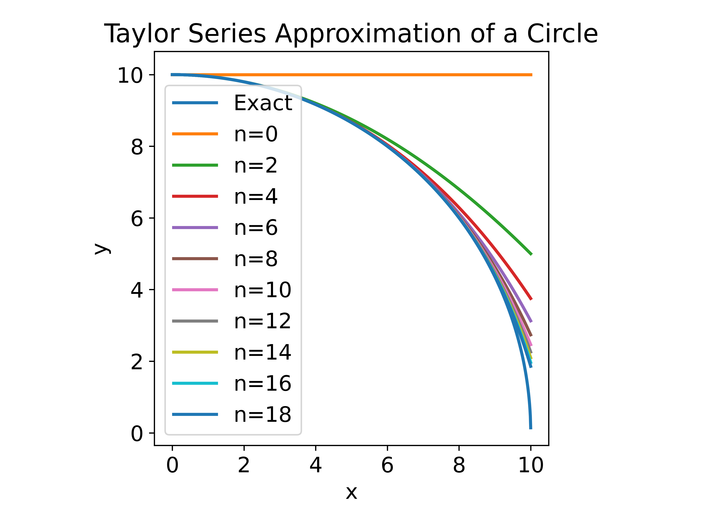
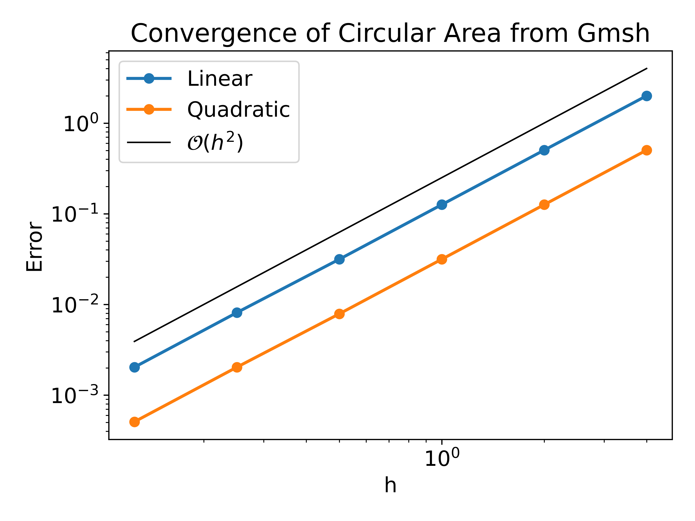

This may seem obvious to some people, but circles are not second-order finite elements. This was not always obvious to me, so I wanted to show some examples of how this breaks down.

The equation for a circle centered at the origin is simply 
\\[
x^2 + y^2 = R^2
\\]
where $$R$$ is the radius of the circle. Considering one-quarter of the circle in the $$x>0$$ and $$y>0$$ quadrant, the equation of interest is then
\\[
y(x) = \sqrt{R^2 - x^2}
\\]
for $$0 < x < R$$.

One can then perform a Taylor expansion of $$y(x)$$ based at $$x=0$$.
\\[
y(x) = \\sum_n \\frac{y^{(n)}(0)}{n!} x
\\]
The first few terms of the derivatives can be written
\\begin{align}
y'(x) &= \\frac{-x}{\\sqrt{R^2 - x^2}} \\\\ y\'\'(x) &= -\\left(\\frac{x^2}{R^2 - x^2} + 1\\right) \\left(R^2 - x^2\\right)^{-1/2} \\\\ y\'\'\'(x) &= -3x \\left(\\frac{x^2}{R^2 - x^2} + 1\\right) \\left(R^2 - x^2\\right)^{-3/2} \\\\ \\cdots
\\end{align}
which makes it obvious that these terms will never become zero. That is, there is no finite-order polynomial that will exactly describe the circle.

I started by saying that this should be obvious for some. Of course, if it were possible to describe a circle with a finite-order polynomial, it would then be possible to square the circle which is certainly impossible.

We can also see the convergence of these terms visually by plotting the Taylor expansion. I have only plotted the even orders as $$y^{(n)}(0)$$ will be zero for all odd $$n$$.

We can also do a numerical study using [Gmsh](https://gmsh.info). I'm mostly interested in showing that the circle cannot be described exactly by second-order elements. So I will mesh this quarter-circle using linear and quadratic finite elements and express the error in the area as a function of the characteristic mesh size.

We can see that the quadratic finite elements generated by Gmsh are always more accurate than the corresponding linear elements. However, we also see that both only converge to the true area at a second-order convergence rate. In practice, this means that the quadratic finite elements are "one level finer" than the linear finite elements.

I suspect that this says more about the Gmsh algorithm for generating second-order finite elements than it does about quadratic finite elements more generally.
